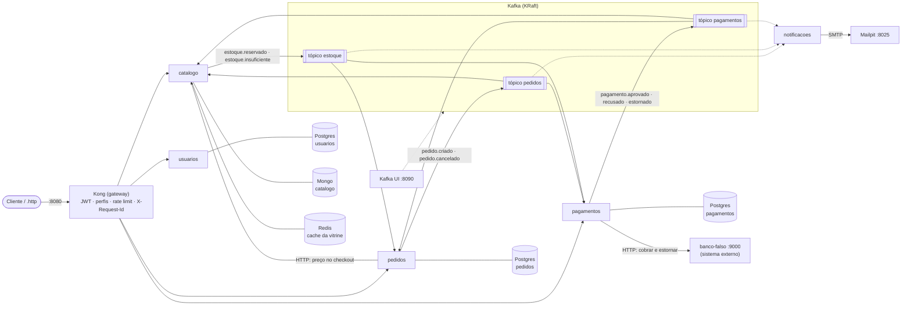

# E-commerce G2 — microserviços

**Autor:** Cairo (trabalho individual)

Projeto da disciplina de Arquitetura de Sistemas: um e-commerce em microserviços, construído uma
peça por aula (usuários e catálogo, gateway e pedidos, Kafka e eventos, saga e resiliência,
observabilidade e cache). O cliente compra pelo gateway; o pedido anda sozinho por eventos: o
catálogo reserva o estoque, o pagamentos cobra num banco de cartão de mentira (com timeout, retry e
circuit breaker) e, se algo der errado, cada serviço desfaz a própria parte. Cada serviço tem o seu
banco, cada um diz como está de saúde, a vitrine tem cache, e tudo sobe com um comando.

---

## Subir

Pré-requisito: Docker com o Compose. Num clone novo, sem nenhum passo a mais (nem `.env`):

```bash
docker compose up -d --build
```

A primeira vez compila 6 imagens Java e leva alguns minutos. As tabelas, os seeds e os tópicos do
Kafka são criados sozinhos na subida, e subir de novo não duplica nada. O gateway só sobe depois
que os serviços da API ficam `healthy`; quando o comando termina, falta só o próprio Kong terminar de
iniciar (alguns segundos, até ele aparecer `healthy`).

```bash
docker compose ps        # todos "Up ... (healthy)"
```

Depois, abra [`http/fluxo-completo.http`](http/fluxo-completo.http) no VS Code (extensão REST
Client) e rode de cima para baixo: login, carrinho, checkout e o pedido chega a `PAGO`.

| O quê | Onde | Observação |
|---|---|---|
| API da loja (Kong) | http://localhost:8080 | a única porta da API |
| Saúde de cada serviço | http://localhost:8080/health/usuarios (e `/catalogo`, `/pedidos`, `/pagamentos`) | público, sem token |
| banco-falso (banco do cartão) | http://localhost:9000/config | fora do Kong: é um sistema "externo" |
| Kafka UI | http://localhost:8090 | tópicos, mensagens, grupos e lag (só nesta máquina) |
| Mailpit | http://localhost:8025 | os e-mails que a loja mandou (só nesta máquina) |
| Kong Admin / Manager | http://localhost:8001 · http://localhost:8002 | só leitura, só nesta máquina |

Serviços, bancos, Redis e Kafka não publicam porta: só o gateway os alcança. Para zerar tudo
(apaga os dados; o seed roda de novo): `docker compose down -v`. Mudou o
[`kong/kong.yml`](kong/kong.yml)? `docker compose restart gateway`.

Memória: são 6 JVMs, Kafka, Mongo, Redis e 3 Postgres. O compose limita o heap de cada um para
caber num WSL de 2 GB, mas aí tudo fica lento (trocando com o swap); 4 GB para o Docker é o
confortável. Os limites podem ser trocados por variável (`JAVA_OPTS_SERVICOS`, `KAFKA_HEAP_OPTS`).

Docker direto no WSL (sem o Docker Desktop)? O WSL desliga a distribuição segundos depois do último
comando `wsl`, e os containers caem juntos ("Exited (255)" sem motivo aparente). No
`%USERPROFILE%\.wslconfig`:

```ini
[wsl2]
memory=3GB
swap=4GB

[general]
instanceIdleTimeout=-1
```

e `wsl --shutdown` para valer.

### Usuários do seed

| E-mail | Senha | Perfil |
|---|---|---|
| `admin@loja.com` | `admin123` | admin |
| `cliente@loja.com` | `cliente123` | cliente (com 1 endereço) |

O catálogo nasce com 3 categorias (`celulares`, `roupas`, `livros`) e 12 produtos.
Os seeds são idempotentes: subir de novo não duplica nada.

---

## Arquitetura



Linha cheia: quem reage e muda dados. Pontilhada: quem só escuta (o notificacoes, para avisar o
cliente) ou só olha (o Kafka UI).

| Serviço | Pasta | Banco | Responsabilidade |
|---|---|---|---|
| gateway | [`kong/`](kong) | — (declarativo) | Kong: rotas, JWT, perfis, rate limit, X-Request-Id |
| usuarios | [`usersApi/`](usersApi) | Postgres | cadastro, login (emite o JWT) e endereços |
| catalogo | [`catalog-api/`](catalog-api) | Mongo + Redis (cache) | produtos, categorias, estoque, reserva e a vitrine com cache |
| pedidos | [`order-api/`](order-api) | Postgres | carrinho, checkout, status e cancelamento do pedido |
| pagamentos | [`payment-api/`](payment-api) | Postgres | cobra no banco (timeout, retry, circuit breaker) e estorna |
| notificacoes | [`notification-api/`](notification-api) | — | escuta os eventos e manda e-mail |
| banco-falso | [`fake-bank/`](fake-bank) | — (memória) | o banco do cartão: recusa, demora e falha sob comando |
| kafka · kafka-ui | — | — | Kafka 3.8 (KRaft, um broker), tópicos `pedidos`, `estoque` e `pagamentos` |
| redis | — | — | cache da vitrine do catálogo, sem persistência |
| mailpit | — | — | SMTP de mentira com caixa de entrada |

Dentro da rede do Docker, todo serviço escuta na 3000 e é chamado pelo nome
(`http://catalogo:3000`). Rodando sem Docker, cada um usa a sua porta (3001 a 3005, banco-falso
na 9000).

Stack: Java 21, Spring Boot 4.1, Spring Data JPA / MongoDB / Redis / JDBC, Spring for Apache Kafka,
Resilience4j, Kafka 3.8 (KRaft), Redis 7, Kong 3.9 (sem banco), Mailpit, Docker Compose.

---

## Rotas

Todas pelo gateway (`http://localhost:8080`). O acesso é conferido pelo Kong: **logado** = token
válido (401 se não); **admin** = token válido com perfil admin (403 se for cliente).

### usuarios

| Método | Rota | Acesso | Retornos |
|---|---|---|---|
| POST | `/auth/login` | público | 200 `{ token, usuario }` · 401 · 429 na 11ª tentativa no minuto |
| POST | `/usuarios` | público | 201 · 400 · 409 e-mail já existe |
| GET | `/usuarios/me` | logado | 200 · 401 |
| PUT | `/usuarios/me` | logado | 200 · 400 · 409 |
| GET | `/usuarios/me/enderecos` | logado | 200 |
| POST | `/usuarios/me/enderecos` | logado | 201 · 400 |
| DELETE | `/usuarios/me/enderecos/{id}` | logado | 204 · 404 não existe ou não é meu |
| GET | `/usuarios` | admin | 200 · 401 · 403 |
| GET | `/health/usuarios` | público | 200 `ok` · 503 `fora do ar` (sem banco) |

### catalogo

| Método | Rota | Acesso | Retornos |
|---|---|---|---|
| GET | `/produtos?categoria=&busca=&ids=` | público | 200 (só ativos), com `X-Cache` · `ids=a,b,c` é a chamada do checkout, sem cache |
| GET | `/produtos/{id}` | público | 200 com `X-Cache` · 404 |
| POST | `/produtos` | admin | 201 · 400 · 401 · 403 · 409 SKU já existe |
| PUT | `/produtos/{id}` | admin | 200 · 400 · 401 · 403 · 404 · 409 |
| PATCH | `/produtos/{id}/estoque` | admin | 200 · 400 estoque negativo · 401 · 403 · 404 |
| DELETE | `/produtos/{id}` | admin | 204 desativado · 401 · 403 · 404 |
| GET | `/categorias` | público | 200 com `X-Cache` |
| POST | `/categorias` | admin | 201 · 400 · 401 · 403 · 409 slug já existe |
| GET | `/health/catalogo` | público | 200 `ok` ou `degradado` (Redis fora) · 503 `fora do ar` (sem Mongo ou Kafka) |

As rotas de admin do catálogo, abertas na aula 1 (ADR-004), agora são fechadas pelo gateway.

### pedidos

| Método | Rota | Acesso | Retornos |
|---|---|---|---|
| GET | `/carrinho` | logado | 200 `{ itens, total }` com preços atuais do catálogo (catálogo fora: itens sem preço + `aviso`) |
| POST | `/carrinho/itens` | logado | 201 item adicionado (soma se já estiver) · 400 quantidade inválida · 404 produto não existe · 503 |
| DELETE | `/carrinho/itens/{produtoId}` | logado | 204 removido · 404 não está no carrinho |
| POST | `/pedidos` | logado | 202 pedido aceito (`AGUARDANDO_ESTOQUE`) · 400 carrinho vazio · 409 produto indisponível · 503 catálogo fora |
| GET | `/pedidos` | logado | 200 meus pedidos |
| GET | `/pedidos/{id}` | logado | 200 pedido com itens e status atual (`motivoCancelamento` se cancelado) · 404 não existe ou não é meu |
| POST | `/pedidos/{id}/cancelar` | logado | 200 cancelado (em `AGUARDANDO_ESTOQUE` ou `AGUARDANDO_PAGAMENTO`), publica `pedido.cancelado` · 404 · 409 status não permite (ex.: `PAGO`) · 503 Kafka fora (não cancela) |
| GET | `/health/pedidos` | público | 200 `ok` · 503 `fora do ar` (sem banco ou Kafka) |

Corpo do checkout (os itens vêm do carrinho):

```json
{
  "enderecoEntrega": { "cep": "90010-000", "logradouro": "Rua A", "numero": "100",
                       "cidade": "Porto Alegre", "uf": "RS" },
  "formaPagamento": "cartao",
  "numeroCartao": "4111111111111111"
}
```

`formaPagamento`: `cartao`, `pix` ou `boleto`. `numeroCartao` só para cartão; o pedido guarda só
os 4 últimos dígitos. Cartão terminado em `0002` é recusado pelo banco-falso (saldo insuficiente).

### pagamentos

O pagamento nasce e muda por eventos; pela API, só se consulta. O Kong deixa passar qualquer perfil
logado e o serviço confere dono e admin (`X-User-Id`, `X-User-Role`).

| Método | Rota | Acesso | Retornos |
|---|---|---|---|
| GET | `/pagamentos/{pedidoId}` | logado | 200 do dono ou de admin · 404 não existe ou é de outra pessoa |
| GET | `/pagamentos` | logado (admin no serviço) | 200 todos · 403 perfil cliente |
| GET | `/health/pagamentos` | público | 200 `ok` ou `degradado` (circuito aberto) · 503 `fora do ar` (sem banco ou Kafka) |

Resposta: `{ id, pedidoId, usuarioId, valor, forma, cartaoFinal, status, tentativas,
codigoTransacao, motivo, criadoEm, atualizadoEm }`. Status: `PENDENTE` (gravado antes de chamar o
banco), `APROVADO`, `RECUSADO` (o banco disse não), `ERRO` (o banco não respondeu: timeout, 503,
circuito aberto), `CANCELADO` (pedido cancelado antes da cobrança), `ESTORNADO` (cobrado e
devolvido). `tentativas` e `motivo` respondem "por que meu pedido foi cancelado?" sem abrir log.

### banco-falso (direto, `http://localhost:9000`, fora do Kong)

| Método | Rota | Retornos |
|---|---|---|
| POST | `/cobrancas` `{ valor, cartaoFinal, referencia, forma }` | 201 `{ aprovado: true, codigo: "TX-..." }` · 402 `{ motivo: "saldo insuficiente" }` (cartão final 0002) · 503 (sorteio de `falhaPercent`) · 400 |
| POST | `/estornos` `{ codigo, referencia }` | 201 estornado (repetir dá 201 igual) · 404 sem cobrança aprovada |
| GET | `/config` | 200 `{ latenciaMs, falhaPercent }` |
| POST | `/config` `{ latenciaMs?, falhaPercent? }` | 200 (muda só o que vier) · 400 fora de 0–60000 / 0–100 |

A `referencia` é o id do pedido e funciona como chave de idempotência: a mesma referência devolve a
mesma resposta, sem cobrar de novo. A cobrança é registrada **antes** de esperar a latência: com
`latenciaMs` acima do timeout de quem chama, o banco cobra e a resposta não chega a tempo. Sem banco
de dados: reiniciou, esqueceu tudo.

---

## Eventos

Coreografia: ninguém manda. Cada serviço reage aos eventos que lhe interessam e publica os seus.

```
POST /pedidos → 202                        POST /pedidos/{id}/cancelar → 200
        │                                                 │
     pedidos ──pedido.criado · pedido.cancelado──► [tópico pedidos]
        ▲                                                 │
        │                         catalogo: reserva (criado) · devolve (cancelado)
        │                         pagamentos: estorna ou bloqueia (cancelado)
        │                                                 │
        │                     estoque.reservado / estoque.insuficiente
        │                                                 ▼
        ├────────────────────────────────────── [tópico estoque] ──► pagamentos ──HTTP──► banco-falso :9000
        │                                                               │  timeout · retry · circuit breaker
        │                                pagamento.aprovado / recusado / estornado
        │                                                               ▼
        └─────────────────────────────────────────────────────── [tópico pagamentos]
     muda o status                                                      │
                                                  catalogo: confirma (aprovado) · devolve (recusado)

     notificacoes escuta os três tópicos ┄┄► e-mail (Mailpit)
```

1. **Checkout**: o pedidos grava o pedido em `AGUARDANDO_ESTOQUE`, publica `pedido.criado` (tópico
   `pedidos`) e responde 202.
2. **Catálogo**: reserva tudo ou nada e publica `estoque.reservado` ou `estoque.insuficiente`
   (tópico `estoque`).
3. **Pagamentos**: escuta o tópico `estoque` (só cobra o que já tem estoque reservado), grava
   `PENDENTE`, cobra no banco e publica `pagamento.aprovado` ou `pagamento.recusado` (tópico
   `pagamentos`).
4. **Pedidos**: escuta `estoque` e `pagamentos` e muda o status: `AGUARDANDO_PAGAMENTO`, `PAGO` ou
   `CANCELADO` com o motivo.
5. **Catálogo**, de novo: `pagamento.aprovado` confirma a reserva (sai do reservado);
   `pagamento.recusado` e `pedido.cancelado` devolvem o estoque (a compensação).
6. **Notificações**: escuta os três tópicos e avisa o cliente.

| Evento | Tópico | Publica | Consome | dados |
|---|---|---|---|---|
| `pedido.criado` | `pedidos` | pedidos | catalogo, notificacoes | `usuarioId`, `clienteEmail`, `itens` (`produtoId`, `nome`, `precoUnitario`, `quantidade`), `valorTotal`, `formaPagamento`, `cartaoFinal` (só cartão) |
| `pedido.cancelado` | `pedidos` | pedidos (cliente cancelou) | catalogo (devolve o estoque), pagamentos (estorna ou bloqueia) | `usuarioId`, `clienteEmail`, `valorTotal`, `formaPagamento`, `cartaoFinal`, `motivo` |
| `estoque.reservado` | `estoque` | catalogo | pedidos, pagamentos | `usuarioId`, `clienteEmail`, `valorTotal`, `formaPagamento`, `cartaoFinal` (só cartão) |
| `estoque.insuficiente` | `estoque` | catalogo | pedidos, notificacoes | `motivo`, `usuarioId`, `clienteEmail` |
| `pagamento.aprovado` | `pagamentos` | pagamentos | pedidos (`PAGO`), catalogo (confirma), notificacoes | `usuarioId`, `clienteEmail`, `valor`, `codigoTransacao`, `tentativas` |
| `pagamento.recusado` | `pagamentos` | pagamentos | pedidos (`CANCELADO`), catalogo (devolve), notificacoes | `usuarioId`, `clienteEmail`, `valor`, `motivo`, `tentativas` |
| `pagamento.estornado` | `pagamentos` | pagamentos | notificacoes | `usuarioId`, `clienteEmail`, `valor`, `codigoTransacao` |

Recusa do banco e banco fora do ar dão no mesmo evento, `pagamento.recusado`, com motivos diferentes
(`saldo insuficiente` ou `banco indisponível (...)`). A saga compensa igual.

E-mails (Mailpit): "Recebemos o seu pedido", "Seu pedido foi cancelado: sem estoque", "Pagamento
aprovado: pedido confirmado", "Seu pedido foi cancelado: pagamento recusado" (com o motivo) e "Seu
pagamento foi estornado".

- **Envelope**, igual em todos os serviços (a classe `evento/Eventos` é a mesma nos quatro que usam
  Kafka):

  ```jsonc
  {
    "id": "b3a1...",                      // único por evento
    "tipo": "pedido.criado",
    "pedidoId": "6f1c...",                // também é a chave da mensagem
    "ocorridoEm": "2026-11-05T16:51:04Z", // quando aconteceu, não quando foi lido
    "correlationId": "3c37be51-...",      // o X-Request-Id do Kong
    "dados": { ... }                      // diferente para cada tipo (tabela acima)
  }
  ```

- **Chave de todas as mensagens**: o id do pedido. Os eventos de um pedido caem na mesma partição e
  chegam em ordem.
- **Tópicos**: criados por quem sobe primeiro (cada serviço declara os que usa; o Spring só cria os
  que não existem), com 3 partições.
- **Group ids**: `pedidos`, `catalogo`, `pagamentos`, `notificacoes`, um por serviço. Réplicas do mesmo serviço
  dividem as partições; grupos diferentes recebem tudo, cada um no seu ritmo.
- **Evento é contrato**: só acrescente campos. Quem lê ignora o que não conhece
  (`@JsonIgnoreProperties(ignoreUnknown = true)`). Precisa quebrar? Publique um tipo novo
  (`pedido.criado.v2`) por um tempo, junto com o antigo.
- **Nunca no evento**: número do cartão, senha, documento. O evento fica guardado no tópico e muita
  gente lê.

### O status do pedido

```
                 estoque.reservado                       pagamento.aprovado
AGUARDANDO_ESTOQUE ───────────────► AGUARDANDO_PAGAMENTO ─────────────────► PAGO
  (nasce no checkout)                        │
        │ estoque.insuficiente               │ pagamento.recusado · cliente cancela
        │ pagamento.recusado · cliente       │
        └──────────────────────────► CANCELADO (motivoCancelamento) ◄──────┘
```

Cada seta só vale a partir do estado de origem (`UPDATE ... WHERE id = ? AND status IN (...)`): um
evento repetido ou atrasado não leva o pedido para trás. O status funciona como cadeado:
`AGUARDANDO_*` diz "isto ainda pode mudar", e um `CANCELADO` não volta a `PAGO` porque o banco
aprovou atrasado. `POST /pedidos/{id}/cancelar` é permitido em `AGUARDANDO_ESTOQUE` e
`AGUARDANDO_PAGAMENTO`; depois de `PAGO`, 409. O `pagamento.aprovado` também vale a partir de
`AGUARDANDO_ESTOQUE` (ADR-022).

---

## A saga da compra

Uma compra atravessa três bancos (Postgres do pedidos, Mongo do catálogo, Postgres do pagamentos):
não existe um `ROLLBACK` que desfaça os três. Cada passo confirma a sua parte na hora e, se algo der
errado depois, é desfeito por uma **compensação**: uma ação nova, que também vira evento.

| Passo (transação local) | Serviço | Compensação | Disparada por |
|---|---|---|---|
| Criar o pedido | pedidos | marcar `CANCELADO` com o motivo | `estoque.insuficiente`, `pagamento.recusado` |
| Reservar o estoque | catalogo | devolver ao disponível | `pagamento.recusado`, `pedido.cancelado` |
| Cobrar o cartão | pagamentos | estornar (ou gravar `CANCELADO` antes de cobrar) | `pedido.cancelado` |
| Avisar o cliente | notificacoes | mandar outro e-mail | `pagamento.recusado`, `pagamento.estornado` |

- **A ordem importa**: o estoque é reservado antes de cobrar porque devolver estoque é um `UPDATE` no
  nosso banco, de graça; estornar custa taxa e aparece no extrato. Sem estoque, o banco nem é chamado.
- **Cada serviço conhece só a própria compensação**: o catálogo não sabe por que o pagamento falhou,
  só escuta `pagamento.recusado` e devolve.
- **Compensação idempotente**: o catálogo só devolve se a reserva ainda estiver `RESERVADO` (ou
  `CONFIRMADO`, no cancelamento durante a cobrança), num `findAndModify` com o status no filtro;
  devolver duas vezes não acontece. O pagamentos só estorna o que está `APROVADO`.
- **Cancelado no meio da cobrança**: o `pedido_id UNIQUE` resolve os dois casos. Se o
  `pedido.cancelado` chega antes da cobrança, o pagamentos grava `CANCELADO` e o `estoque.reservado`
  que vier depois é ignorado (o banco nem é chamado). Se chega depois de aprovado, estorna e publica
  `pagamento.estornado`. Os dois finais estão certos: ninguém paga por um pedido cancelado.

## Resiliência: a chamada ao banco

Só o pagamentos chama um sistema externo, e é ali que ficam as defesas
([`CobrancaResiliente`](payment-api/src/main/java/br/com/ecommerce/pagamentos/banco/CobrancaResiliente.java)):

| Padrão | Configuração | Por quê |
|---|---|---|
| **Timeout** | 2 s por chamada (`banco.timeout`) | sem timeout, o `HttpURLConnection` espera para sempre e prende a thread |
| **Retry** | até 3 tentativas, esperando 500 ms e 1 s, mais jitter; só em timeout, sem conexão, 5xx e 429 | 402 e outros 4xx são respostas: repetir não muda o "não" |
| **Idempotência** | a `referencia` (id do pedido) em toda tentativa | o retry de uma cobrança que o banco já fez devolve a mesma, sem cobrar duas vezes |
| **Circuit breaker** | Resilience4j: abre com 50% de falha em pelo menos 5 chamadas (janela das últimas 10), espera 15 s, meio-aberto deixa 1 chamada testar | quem chama descobre na hora, e o banco doente ganha um respiro |
| **Fallback** | esgotou ou circuito aberto: `ERRO` e `pagamento.recusado` com "banco indisponível (...)" | o pedido não fica parado esperando um banco que caiu: a saga compensa |
| **Estorno de segurança** | se alguma tentativa deu timeout e o resultado foi `ERRO`: estorno pela referência | timeout é "não sei": o banco pode ter cobrado. Sem cobrança, o banco responde 404 e tudo bem |

Para o circuito, falha é só `BancoIndisponivelException` (timeout, sem conexão, 5xx). Um 402 é o
banco respondendo: sucesso. O estorno não passa pelo circuit breaker (devolver dinheiro é importante
demais para ser barrado) e tem timeout maior (10 s). O retry fica só nesta camada, a mais próxima de
quem falha; o pedidos → catálogo continua sem retry (o cliente está esperando o checkout).

---

## Observabilidade

Um cliente diz "minha compra não terminou". Três coisas dizem em qual caixa está o problema: a
saúde de cada serviço, o Docker de olho nela, e os logs com o mesmo id do começo ao fim.

### Saúde: `/health` em todos os serviços

```json
{ "servico": "pagamentos", "status": "degradado",
  "dependencias": { "banco": "ok", "kafka": "ok", "circuitoBancoExterno": "aberto" } }
```

| Status | Quer dizer | HTTP |
|---|---|---|
| `ok` | tudo funcionando | 200 |
| `degradado` | funciona, mas pior: cache fora, circuito do banco do cartão aberto | 200 |
| `fora do ar` | não consegue trabalhar: sem o próprio banco ou sem o Kafka | 503 |

| Serviço | Dependências testadas | Fora do ar sem | Degradado com |
|---|---|---|---|
| usuarios | `banco` (SELECT 1) | banco | — |
| catalogo | `banco` (ping no Mongo), `kafka`, `cache` (PING no Redis) | banco, Kafka | Redis fora |
| pedidos | `banco`, `kafka` | banco, Kafka | — |
| pagamentos | `banco`, `kafka`, `circuitoBancoExterno` | banco, Kafka | circuito aberto ou meio-aberto |
| notificacoes | `kafka`, `smtp` (só abre a conexão) | Kafka, SMTP | — |
| banco-falso | — | — | — |

Cada health testa de verdade (uma consulta ao banco, um `describeCluster` no Kafka, um `PING` no
Redis) e é barato: nada de consulta pesada nem chamada a outro serviço. O pedidos **não** chama o
`/health` do catálogo: se chamasse, uma queda do catálogo marcaria o pedidos como doente à toa. O
que só acelera (o cache) ou está fora do nosso controle (o banco do cartão) deixa o serviço
`degradado`, nunca `fora do ar`. Pelo Kong: `/health/<servico>`, público. O notificacoes não tem
rota no Kong; o health dele é só para o Docker.

### O Docker de olho

Cada serviço tem `healthcheck` no compose: a cada 10 s, o Docker chama o `/health` de dentro do
container (`wget`); 3 falhas seguidas (o 503 conta como falha) e ele vira `unhealthy`. O
`start_period` de 120 s dá tempo de subir (esperar o Kafka, rodar o seed). Os bancos, o Redis e o
Kafka também têm o seu (`pg_isready`, `mongosh ping`, `redis-cli ping`, `kafka-topics --list`).
Com `depends_on: service_healthy`, quem depende só sobe quando o outro está de fato pronto: os
serviços esperam o banco e o Kafka, e o gateway espera os serviços da API.

```bash
docker compose ps                     # todos (healthy)
docker compose stop pagamentos-db     # em ~30 s: pagamentos (unhealthy), /health/pagamentos 503
docker compose start pagamentos-db    # volta a healthy sozinho
```

O Docker só marca; quem agiria (reiniciar, tirar do balanceamento) é um orquestrador, como o
Kubernetes.

### Logs: uma compra, um id

O gateway dá um `X-Request-Id` a cada requisição, repassa a todos os serviços e devolve na
resposta. Cada serviço escreve uma linha por requisição com o id entre colchetes, e toda linha de
log escrita durante ela também leva o id (ex.: o aviso de catálogo fora, no pedidos):

```
INFO --- [pedidos] [nio-3000-exec-1] [3c37be51-...] b.c.e.pedidos.config.RequestIdFilter : POST /pedidos -> 202 (48 ms)
INFO --- [catalogo] [nio-3000-exec-3] [3c37be51-...] b.c.e.catalogo.config.RequestIdFilter : GET /produtos -> 200 (9 ms)
```

O id também vai dentro de cada evento (`correlationId`) e segue de evento em evento: quem trata o
evento escreve o log com ele, e os eventos que publica em seguida levam o mesmo id. Uma compra
inteira, do checkout ao e-mail:

```
[pedidos]      [3c37be51-...] Publicado pedido.criado do pedido 6f1c... no tópico pedidos
[catalogo]     [3c37be51-...] Pedido 6f1c...: estoque reservado (2 itens)
[catalogo]     [3c37be51-...] Publicado estoque.reservado do pedido 6f1c... no tópico estoque
[notificacoes] [3c37be51-...] E-mail "Recebemos o seu pedido" enviado para c***@loja.com
[pedidos]      [3c37be51-...] Pedido 6f1c... agora está AGUARDANDO_PAGAMENTO
[pagamentos]   [3c37be51-...] Pedido 6f1c...: tentativa 1/3 falhou: HTTP 503
[pagamentos]   [3c37be51-...] Pedido 6f1c...: tentativa 2/3 aprovada (TX-F6A1B2C3)
[pagamentos]   [3c37be51-...] Publicado pagamento.aprovado do pedido 6f1c... no tópico pagamentos
[catalogo]     [3c37be51-...] Pedido 6f1c...: venda confirmada, 2 itens saíram do reservado
[pedidos]      [3c37be51-...] Pedido 6f1c... agora está PAGO
[notificacoes] [3c37be51-...] E-mail "Pagamento aprovado: pedido confirmado" enviado para c***@loja.com
```

Com o id da resposta (ou de um chamado de suporte), um grep acha a história inteira, passando por
pedidos, catálogo, pagamentos e notificações:

```bash
docker compose logs -t --no-log-prefix | grep 3c37be51 | sort
```

Toda linha de evento (publicou, recebeu, compensou) tem o id do pedido e o `correlationId`. Nunca
vão para o log: senha, token, número de cartão (só os 4 últimos dígitos) e e-mail inteiro (sai
`c***@loja.com`). O `/health`, chamado pelo Docker a cada 10 s, também não é logado.

### O que vigiar

| Sinal | Onde ver | Preocupa quando |
|---|---|---|
| Latência do checkout | a linha de cada requisição no log do pedidos (`POST /pedidos -> 202 (48 ms)`) ou o cabeçalho `X-Kong-Upstream-Latency` da resposta | passa de 1 s |
| Erros | respostas 5xx no Kong; pagamentos `ERRO` | sobem de repente |
| Saturação | lag dos grupos no Kafka UI | só cresce: os serviços estão "no ar" e o trabalho acumula |
| Dependência externa | `/health/pagamentos` | circuito `aberto` por minutos |
| Saúde | `docker compose ps` | qualquer `unhealthy` |

---

## Cache da vitrine (Redis)

A vitrine é lida mil vezes para cada vez que um produto muda. O catálogo guarda no Redis a resposta
inteira de `GET /produtos` (uma chave por filtro), `GET /produtos/{id}` e `GET /categorias`, no
padrão **cache-aside**:

| `X-Cache` | O que aconteceu |
|---|---|
| `MISS` | não estava no Redis: buscou no Mongo, guardou por 60 s (TTL) e devolveu |
| `HIT` | estava no Redis: devolveu sem ir ao Mongo |
| `OFF` | Redis fora: foi direto ao Mongo. O cache acelera, não sustenta |

**Invalidação por versão.** As chaves têm a versão no nome: `catalogo:v7:produtos?categoria=roupas&busca=`.
Toda escrita (criar, alterar, desativar produto; ajustar estoque; criar categoria) e toda mudança
de estoque por evento (reserva, venda confirmada, devolução) faz um único `INCR catalogo:versao`. A
próxima leitura monta o nome com a versão 8, não acha (MISS) e busca o dado novo; as chaves da
versão 7 ninguém mais procura e vencem sozinhas pelo TTL. Um comando apaga todas as listagens de
uma vez.

- **O checkout nunca usa o cache**: `GET /produtos?ids=...` (a chamada do pedidos) vai sempre ao
  Mongo. Ninguém paga o preço de uma vitrine guardada.
- **Redis fora**: a vitrine continua (`OFF`), o `/health/catalogo` fica `degradado` (200), e as
  próximas requisições pulam o Redis por 5 s em vez de cada uma esperar o timeout (300 ms).
- **Sem persistência** (`--save ""`, sem AOF): reiniciado, o Redis volta vazio, nunca com dado velho.
  `maxmemory 64mb` com `volatile-lru`: só descarta chave com TTL (a versão não tem TTL).
- **TTL com variação** de até 10%: as chaves criadas juntas não vencem todas no mesmo segundo.
- O que **não** tem cache: carrinho, pedido, pagamento (um valor velho ali custa dinheiro ou
  confunde quem espera o status mudar).

```bash
docker compose exec redis redis-cli GET catalogo:versao
docker compose exec redis redis-cli --scan --pattern 'catalogo:*'
docker compose exec redis redis-cli TTL 'catalogo:v3:categorias'
```

---

## Demonstração

Arquivos em [`http/`](http), para a extensão **REST Client** do VS Code. Todos usam uma URL só, a do
gateway; rode de cima para baixo (as requisições com `# @name` guardam token e ids para as
seguintes, nada é fixo no arquivo).

| Arquivo | O que mostra |
|---|---|
| [`fluxo-completo.http`](http/fluxo-completo.http) | **a entrega final**: login → vitrine → carrinho → checkout (202) → pedido até `PAGO` → pagamento; cartão 0002 (`CANCELADO`, estoque de volta); cancelamento com estorno; cliente em rota de admin (403); cache MISS/HIT e invalidação |
| [`fluxo-compra.http`](http/fluxo-compra.http) | a saga com mais detalhe: estoque antes e depois, quem vê qual pagamento |
| [`demos.http`](http/demos.http) | resiliência: 30% de falha (o retry resolve), 100% (o circuito abre e fecha), 3 s de latência (timeout e estorno de segurança) |
| [`usuarios.http`](http/usuarios.http) · [`catalogo.http`](http/catalogo.http) · [`pedidos.http`](http/pedidos.http) | todas as rotas de cada serviço e os erros (400, 401, 403, 404, 409, 503) |

### A saga, a recusa e o cancelamento

Em `fluxo-completo.http`: a compra com cartão `4111...` termina `PAGO` (pagamento `APROVADO`); com
cartão final `0002`, o banco recusa, o pedido vira `CANCELADO` com o motivo e o estoque volta;
com o banco-falso lento (1,5 s), o cancelamento logo depois do checkout termina com o pagamento
`ESTORNADO` (ou `CANCELADO`, se o cancelamento chegou antes da cobrança). Os e-mails de cada caso
aparecem no Mailpit.

### O circuit breaker

Com o [`http/demos.http`](http/demos.http), ou com curl:

```bash
docker compose logs -f pagamentos banco-falso          # num terminal
curl -X POST localhost:9000/config -H 'Content-Type: application/json' -d '{"falhaPercent":100}'
# faça 2 ou 3 compras (pix): cada uma aparece com "tentativa N/3 falhou: HTTP 503"
# no log: "CIRCUITO ABERTO"; a próxima compra nem chama o banco ("circuito aberto, cobrança não tentada")
curl localhost:8080/health/pagamentos                  # "status": "degradado", circuitoBancoExterno "aberto"
curl -X POST localhost:9000/config -H 'Content-Type: application/json' -d '{"falhaPercent":0}'
# espere 15 s: "CIRCUITO MEIO-ABERTO" e /health com o circuito "meio-aberto"
# faça mais uma compra: a chamada de teste passa, "CIRCUITO FECHADO" e /health "ok", circuito "fechado"
```

Os pedidos que pegaram o circuito aberto ficam `CANCELADO` com "Pagamento recusado: banco
indisponível (circuito aberto).", o estoque volta e o cliente recebe o e-mail com o motivo.

### O cache

```bash
curl -si 'localhost:8080/produtos?categoria=roupas' | grep X-Cache    # MISS
curl -si 'localhost:8080/produtos?categoria=roupas' | grep X-Cache    # HIT
# o admin muda o preço (PUT /produtos/{id}, em catalogo.http): o próximo GET já mostra o novo (MISS)
docker compose stop redis
curl -si 'localhost:8080/produtos?categoria=roupas' | grep X-Cache    # OFF, e a vitrine responde
curl -s localhost:8080/health/catalogo                                # "degradado", 200
docker compose start redis
```

---

## Decisões de arquitetura

Uma por arquivo em [`docs/adr/`](docs/adr), com contexto, decisão e consequências (o que se ganhou
e o que se perdeu).

| ADR | Decisão | Situação |
|---|---|---|
| [ADR-001](docs/adr/001-persistencia-poliglota-postgres-no-usuarios-mongo-no.md) | Persistência poliglota: Postgres no usuarios, Mongo no catalogo | em vigor |
| [ADR-002](docs/adr/002-esquema-do-postgres-gerado-pelo-hibernate-ddl.md) | Esquema do Postgres gerado pelo Hibernate (`ddl-auto=update`), sem migrations | em vigor |
| [ADR-003](docs/adr/003-jwt-com-spring-security-validado-no-proprio.md) | JWT com Spring Security, validado no próprio serviço usuarios | substituído |
| [ADR-004](docs/adr/004-rotas-de-admin-do-catalogo-abertas-ate.md) | Rotas de admin do catálogo abertas até a aula 2 | resolvido |
| [ADR-005](docs/adr/005-delete-de-produto-e-exclusao-logica-ativo.md) | DELETE de produto é exclusão lógica (`ativo = false`) | em vigor |
| [ADR-006](docs/adr/006-patch-produtos-id-estoque-define-o-valor.md) | `PATCH /produtos/{id}/estoque` define o valor disponível | em vigor |
| [ADR-007](docs/adr/007-preco-como-bigdecimal-decimal128.md) | Preço como `BigDecimal` / `Decimal128` | em vigor |
| [ADR-008](docs/adr/008-api-gateway-com-kong-sem-banco-kong.md) | API Gateway com Kong sem banco (`kong/kong.yml`) | em vigor |
| [ADR-009](docs/adr/009-os-servicos-confiam-nos-cabecalhos-x-user.md) | Os serviços confiam nos cabeçalhos X-User-* e não validam token | em vigor |
| [ADR-010](docs/adr/010-todo-servico-escuta-na-porta-3000-dentro.md) | Todo serviço escuta na porta 3000 dentro da rede | em vigor |
| [ADR-011](docs/adr/011-o-checkout-chama-o-catalogo-direto-de.md) | O checkout chama o catálogo direto, de forma síncrona, com timeout de 3 s | em vigor |
| [ADR-012](docs/adr/012-o-pedido-copia-nome-preco-e-endereco.md) | O pedido copia nome, preço e endereço; sem FK para outros serviços | em vigor |
| [ADR-013](docs/adr/013-checkout-responde-202-e-o-pedido-nasce.md) | Checkout responde 202 e o pedido nasce em `AGUARDANDO_ESTOQUE` | atualizado |
| [ADR-014](docs/adr/014-checkout-por-eventos-kafka-em-coreografia.md) | Checkout por eventos (Kafka), em coreografia | em vigor |
| [ADR-015](docs/adr/015-publicar-depois-do-commit-sem-outbox.md) | Publicar depois do commit, sem Outbox | em vigor |
| [ADR-016](docs/adr/016-idempotencia-reservas-por-pedido-e-filtro-de.md) | Idempotência: reservas por pedido e filtro de estado | em vigor |
| [ADR-017](docs/adr/017-spring-for-apache-kafka-no-lugar-do.md) | Spring for Apache Kafka no lugar do kafkajs dos slides | em vigor |
| [ADR-018](docs/adr/018-saga-coreografada-com-uma-compensacao-por-servico.md) | Saga coreografada, com uma compensação por serviço | em vigor |
| [ADR-019](docs/adr/019-resiliencia-so-na-chamada-ao-banco-timeout.md) | Resiliência só na chamada ao banco: timeout, retry local e Resilience4j | em vigor |
| [ADR-020](docs/adr/020-pagamentos-com-jdbc-e-schema-sql-sem.md) | Pagamentos com JDBC e `schema.sql`, sem JPA | em vigor |
| [ADR-021](docs/adr/021-cancelar-publica-o-pedido-cancelado-antes-do.md) | Cancelar publica o `pedido.cancelado` antes do commit | em vigor |
| [ADR-022](docs/adr/022-pago-tambem-a-partir-de-aguardando-estoque.md) | `PAGO` também a partir de `AGUARDANDO_ESTOQUE` | em vigor |
| [ADR-023](docs/adr/023-pagamentos-ouve-os-dois-topicos-num-listener.md) | Pagamentos ouve os dois tópicos num listener só | em vigor |
| [ADR-024](docs/adr/024-health-com-tres-estados-sem-chamar-outros.md) | `/health` com três estados, sem chamar outros serviços | em vigor |
| [ADR-025](docs/adr/025-cache-aside-no-redis-so-na-vitrine.md) | Cache-aside no Redis, só na vitrine, invalidado por versão | em vigor |
| [ADR-026](docs/adr/026-sobe-do-zero-com-um-comando-valores.md) | Sobe do zero com um comando: valores padrão no compose e memória limitada | em vigor |

---

## Limitações conhecidas

| Problema | O que acontece hoje | Como se resolve |
|---|---|---|
| **Escrita dupla** | O pedido é gravado e o Kafka cai antes do `pedido.criado`: o pedido fica parado em `AGUARDANDO_ESTOQUE` para sempre (há um `ERROR` no log com o id). No pagamentos é pior: o pagamento fica gravado `APROVADO` e, se o Kafka não voltar dentro das 3 tentativas do tratador de erros (cerca de 30 s), o `pagamento.aprovado` se perde. O cliente foi cobrado, o pedido fica em `AGUARDANDO_PAGAMENTO` e o estoque, reservado (aconteceu de verdade num teste com o WSL travado). | Padrão **Outbox**: gravar o evento numa tabela na mesma transação do pedido; um publicador lê a tabela e publica até conseguir. |
| **Mensagem venenosa** | Um evento que dá erro sempre é tentado 3 vezes (1 s entre elas) e depois **pulado**; só fica o erro no log. | Mandar para um tópico de erros (**DLQ**) para analisar e reprocessar. |
| **Reserva pela metade** | Se o catálogo cair no meio da reserva de um pedido, a reserva fica `PROCESSANDO`; quando o evento chega de novo, é ignorado (não dá para saber o que já saiu do estoque). | Transação no Mongo envolvendo a reserva e os produtos, ou Outbox também no catálogo. |
| **Estorno que falha** | O banco não responde ao estorno: o Kafka entrega o `pedido.cancelado` mais 2 vezes (cada uma com 3 tentativas) e desiste; fica um `ERROR` no log e o pagamento continua `APROVADO`. O cliente pagou por um pedido cancelado e nenhuma tabela mostra isso. | Status `ESTORNO_PENDENTE`, uma rotina que reprocessa com espera crescente, alerta para o financeiro (DLQ) e a conciliação diária com o banco. |
| **Compensação pela metade** | Se o catálogo cair entre marcar a reserva `LIBERADO` e devolver cada item, o evento que chegar de novo encontra a reserva já liberada e não devolve o resto. | Transação no Mongo envolvendo a reserva e os produtos. |
| **Reserva sem validade** | Se o pagamento nunca terminar (pagamentos fora por horas), o estoque fica preso em `reservado`. | Reservas com prazo: sem confirmação em X minutos, expiram e o estoque volta. |
| **Um circuito por réplica** | O estado do circuit breaker fica na memória de cada réplica do pagamentos: com 3 réplicas, o banco recebe até 3 × 5 chamadas ruins antes de todas abrirem, e por alguns segundos elas discordam. | Para o projeto, aceitável. Estado compartilhado (Redis) ou o circuito na infraestrutura (Envoy, Istio). |
| **Banco caiu = venda perdida** | Banco fora: o pedido é cancelado na hora (fallback mais simples). | Deixar o pedido esperando: pausar o consumo com o circuito aberto, ou uma rotina que cobra os `PENDENTE`, sempre com prazo. Decisão de negócio. |
| **Banco-falso sem disco** | Reiniciou o banco-falso, esqueceu as cobranças: um estorno depois disso dá 404. | É uma simulação; um banco de verdade guarda tudo. |
| **Invalidação do cache que falha** | O Redis caiu no instante de uma escrita: o `INCR catalogo:versao` não acontece e, quando ele volta (sem ter reiniciado), a vitrine pode mostrar o dado velho. | O TTL de 60 s limita o estrago. E o preço da compra nunca vem do cache: o checkout consulta o catálogo sem cache. |
| **Cache invalidado a cada compra** | Toda reserva, confirmação e devolução de estoque troca a versão: com muitas vendas, a vitrine quase não acerta o cache. | Invalidar só as chaves do produto que mudou (uma versão por produto), ou não mostrar o estoque exato na vitrine ("disponível" / "esgotado"). |
| **Pouca memória** | Com 6 JVMs, Kafka, Mongo, Redis e 3 Postgres num WSL de 2 GB, tudo sobe, mas trocando com o swap: um timeout de 2 s ou 3 s pode estourar à toa, e a VM pode travar. | Os limites de heap do compose (`JAVA_OPTS_SERVICOS`, `KAFKA_HEAP_OPTS`) já ajudam; com 3 GB (e 4 GB de swap) para o WSL, a compra inteira passa sem timeout falso (ver [Subir](#subir)). |
| **E-mail repetido** | Pelo menos uma vez: se o mesmo evento for entregue de novo, sai outro e-mail. | Guardar os `id` de evento já tratados. Para um aviso, é aceitável. |
| **Kafka sem disco próprio e com um broker só** | `docker compose down` apaga os tópicos e os offsets; um broker caído para a mensageria. | Volume para os dados e 3 brokers com fator de replicação 3 (produção). |

---

## Desenvolvimento

### Formato de erro

Os serviços respondem no mesmo formato:

```json
{ "erro": "Dados inválidos.", "detalhes": ["preco deve ser maior que zero", "sku é obrigatório"] }
```

Nunca sai stack trace, mensagem do banco ou `senha_hash`. Os erros que o próprio Kong responde
(401 de token, 403 de perfil, 429 de limite, 404 de rota que não existe) vêm no formato dele:
`{ "message": "..." }`.

### Rodar um serviço sem Docker

Com um Postgres e/ou Mongo locais, preencha o `.env` (os serviços leem o `.env` da raiz
automaticamente) e, dentro da pasta do serviço:

```bash
./mvnw spring-boot:run
```

Os bancos `usuarios`, `pedidos` e `pagamentos` precisam existir no Postgres
(`CREATE DATABASE usuarios;` e assim por diante); as tabelas são criadas na subida. O banco-falso
não precisa de nada: `cd fake-bank && ./mvnw spring-boot:run` sobe na 9000. Sem Docker não há gateway: chame os
serviços direto e mande os cabeçalhos que o Kong mandaria (`X-User-Id`, `X-User-Email`,
`X-User-Role`). O Kafka da docker-compose não publica porta: para os serviços falarem com
eventos fora do Docker, suba um Kafka local e aponte `KAFKA_BROKERS` para ele (padrão
`localhost:9092`). O catálogo procura o Redis em `localhost:6379` (`REDIS_HOST`); sem ele, a vitrine
funciona com `X-Cache: OFF` e o `/health` fica `degradado`.

### Testes automatizados

```bash
cd usersApi && ./mvnw test      # H2 em memória, não precisa de banco
cd catalog-api && ./mvnw test   # Mongo embutido (baixado na 1ª execução); o Redis é um mapa em memória
cd order-api && ./mvnw test     # H2 em memória; o catálogo é simulado (no ar, lento, fora do ar)
cd notification-api && ./mvnw test   # o SMTP é simulado
cd payment-api && ./mvnw test   # H2 em memória; o banco do cartão é simulado (aprova, recusa, 503, timeout)
cd fake-bank && ./mvnw test     # as regras do banco-falso (0002, idempotência, /config, estornos)
```

Nenhum teste precisa de Kafka: o `KafkaTemplate` é simulado (o teste confere o que seria
publicado: tópico, chave e envelope) e os listeners são chamados direto com a mensagem, como o
Kafka faria. No catálogo, a reserva roda contra o Mongo embutido, inclusive com 8 pedidos ao mesmo
tempo disputando 3 unidades. No pagamentos, o retry e o circuit breaker rodam de verdade contra o
banco simulado (o circuito abre, passa a meio-aberto e fecha), e o `BancoClient` é testado contra um
servidor HTTP do próprio JDK, inclusive o timeout. No catálogo, o cache roda com um "Redis" em
memória que pode ser desligado: MISS e depois HIT, invalidação a cada escrita e a cada mudança de
estoque, e a vitrine respondendo com `X-Cache: OFF` quando ele cai.

### Estrutura

```
.
├── docker-compose.yml        # sobe tudo: gateway, serviços, bancos, Redis, Kafka, Mailpit e banco-falso
├── kong/kong.yml             # configuração do gateway (Kong sem banco)
├── .env.example              # opcional: só para trocar valores ou rodar fora do Docker
├── http/                     # requisições de teste (REST Client); fluxo-completo.http é a entrega final
├── docs/
│   ├── adr/                  # as decisões de arquitetura, uma por arquivo
│   └── discussoes.md         # as perguntas "para discutir em dupla" de cada aula, respondidas
├── usersApi/                 # serviço usuarios
│   ├── Dockerfile
│   ├── pom.xml
│   └── src/main/java/br/com/ecommerce/usuarios/
│       ├── entity/  repository/  dto/  service/  controller/
│       ├── config/  security/  exception/  seed/
├── catalog-api/              # serviço catalogo
│   ├── Dockerfile
│   ├── pom.xml
│   └── src/main/java/br/com/ecommerce/catalogo/
│       ├── document/  repository/  dto/  service/  controller/
│       ├── cache/            # VitrineCache (cache-aside, versão, X-Cache) e o RedisCacheStore
│       ├── evento/           # Eventos (envelope), PedidosListener, PagamentosListener, dados do estoque.*
│       ├── exception/  seed/
├── order-api/                # serviço pedidos
│   ├── Dockerfile
│   ├── pom.xml
│   └── src/main/java/br/com/ecommerce/pedidos/
│       ├── entity/  repository/  dto/  service/  controller/
│       ├── evento/           # Eventos (envelope), EstoqueListener, PagamentosListener, pedido.criado/cancelado
│       ├── catalogo/  security/  exception/
├── payment-api/              # serviço pagamentos
│   ├── Dockerfile
│   ├── pom.xml
│   └── src/main/
│       ├── resources/schema.sql   # a tabela pagamentos (CREATE TABLE IF NOT EXISTS)
│       └── java/br/com/ecommerce/pagamentos/
│           ├── banco/        # BancoClient (HTTP), CobrancaResiliente (retry), BancoConfig (circuit breaker)
│           ├── evento/       # Eventos (envelope), PagamentosListener, dados dos pagamento.*
│           ├── entity/  repository/  dto/  service/  controller/
│           └── config/  security/  exception/
├── notification-api/         # serviço notificacoes (sem banco, sem porta publicada)
│   ├── Dockerfile
│   ├── pom.xml
│   └── src/main/java/br/com/ecommerce/notificacoes/
│       ├── evento/           # Eventos (envelope), NotificacoesListener
│       └── email/            # EmailService (SMTP → Mailpit)
└── fake-bank/                # banco-falso (sem banco de dados, porta 9000)
    ├── Dockerfile
    ├── pom.xml
    └── src/main/java/br/com/ecommerce/banco/   # BancoController e o /health
```

Cada serviço é independente: seu próprio `pom.xml`, `Dockerfile` e banco. Nenhum importa código
do outro: o que eles compartilham é o formato dos eventos, e por isso a classe `Eventos` é copiada
(igual) em cada um, assim como a `KafkaSaude` do `/health`.

### Para discutir em dupla

As perguntas do fim de cada aula, respondidas com o que o projeto faz:
[`docs/discussoes.md`](docs/discussoes.md).
